<!--
  LEMAN / AFTER HOURS · SHITTIM CHEST ARCHIVES
  Upload README.md AND assets/ to Lemanh1231/Lemanh1231.
-->

<picture>
  <source media="(max-width: 600px)" srcset="./assets/hero-mobile.svg">
  
</picture>

プラナの世界 &nbsp; / &nbsp; A LITTLE CORNER OF MY WORLD

<a href="#about"><kbd>01 · ABOUT</kbd></a> &nbsp; <a href="#arsenal"><kbd>02 · ARSENAL</kbd></a> &nbsp; <a href="#projects"><kbd>03 · PROJECTS</kbd></a> &nbsp; <a href="#connect"><kbd>04 · CONNECT</kbd></a>

**Một chút code. Một chút âm nhạc. Rất nhiều đam mê.**

Building little things that make the everyday a little better.

 

<picture>
  <source media="(max-width: 600px)" srcset="./assets/section-about-mobile.svg">
  
</picture>

Mình là **Leman** (`@lemanh1231`). Mình đam mê lập trình, xây dựng hệ thống stream âm nhạc, giả lập server game và mày mò tối ưu hóa Android/Linux — từ các công cụ tự động hóa, kiểm thử hạ tầng mạng cho đến giao diện mang phong cách cyber anime.

Đây là góc nhỏ lưu lại những dự án mình đang phát triển, những thử nghiệm đang chạy và những ý tưởng đang chờ thành hình.

<picture>
  <source media="(max-width: 600px)" srcset="./assets/terminal-mobile.svg">
  
</picture>

 

<picture>
  <source media="(max-width: 600px)" srcset="./assets/section-arsenal-mobile.svg">
  
</picture>

Những công nghệ và công cụ xuất hiện trong các dự án của mình. Luôn sẵn sàng cho những khám phá mới.

<picture>
  <source media="(max-width: 600px)" srcset="./assets/arsenal-mobile.svg">
  
</picture>

 

<picture>
  <source media="(max-width: 600px)" srcset="./assets/section-projects-mobile.svg">
  
</picture>

Mỗi repo là một ý tưởng được biến thành hiện thực. Chọn một thẻ để khám phá.

<a href="https://github.com/Lemanh1231/GGServer">
  <picture>
    <source media="(max-width: 600px)" srcset="./assets/project-ggserver-mobile.svg">
    
  </picture>
</a>

<a href="https://github.com/Lemanh1231/youtube-proxy-checker">
  <picture>
    <source media="(max-width: 600px)" srcset="./assets/project-proxy-mobile.svg">
    
  </picture>
</a>

<a href="https://github.com/Lemanh1231/HyperLyric-Spotify-Provider-Fix">
  <picture>
    <source media="(max-width: 600px)" srcset="./assets/project-lyric-mobile.svg">
    
  </picture>
</a>

  <a href="https://github.com/Lemanh1231?tab=repositories">Khám phá tất cả repositories ↗</a>

 

<picture>
  <source media="(max-width: 600px)" srcset="./assets/section-connect-mobile.svg">
  
</picture>

**Có ý tưởng thú vị hay muốn cùng thảo luận?**

Một issue, một pull request, hay một thử nghiệm nhỏ cũng có thể mở ra những điều kỳ diệu.

「 少しずつ、前へ。 」

Little by little, moving forward.

 

<picture>
  <source media="(max-width: 600px)" srcset="./assets/footer-mobile.svg">
  
</picture>
